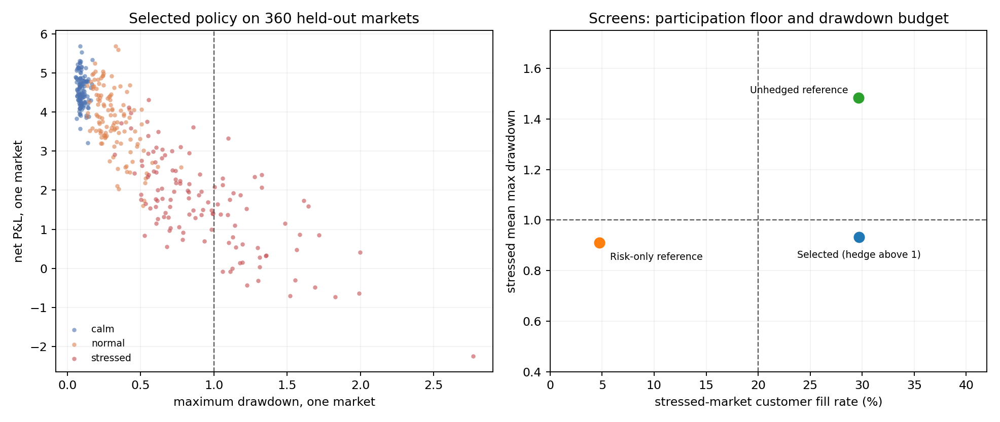
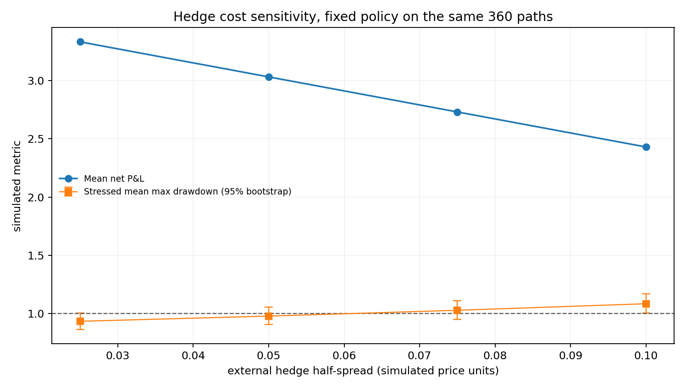
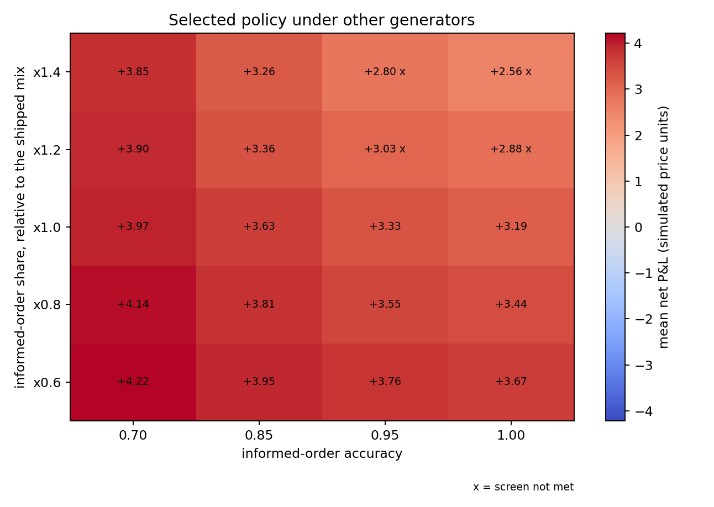

# Inventory-aware market making on synthetic order flow

[](https://github.com/jiahan-wang/market-making-inventory-risk/actions/workflows/ci.yml)

A market maker quotes both sides against a stream of customer orders, carries the
inventory those fills leave behind, and can pay to flatten it at an external venue.
Everything here is generated: no historical prices, no live feed, no return estimate.
Amounts are in simulated price units. The subject is the selection protocol and the
ways it can mislead, not the P&L level.

**What it finds.** On this generator, a maker that skews its quotes on inventory and
widens them with volatility gives up 0.23 of mean P&L per market to cut stressed
drawdown by 0.34, and the trade only survives while the external hedge costs less
than roughly 0.06 half-spread. Of the four screens, only the stressed drawdown
budget comes near its threshold. The others sit far enough away that they never
decided anything.



## Layout

| Directory | Entry point | What it adds |
| --- | --- | --- |
| `stage1` | `simulator.py` | Fixed quote, one customer per round, inventory cap |
| `stage2` | `simulator.py` | Fixed against inventory-aware quoting on matched markets, 200 scenarios |
| `stage3` | `experiment.py` | Informed flow, three regimes, volatility-adaptive quoting, train/test split |
| `stage4` | `risk_preference_experiment.py` | Drawdown penalty in the training objective, confirmed on fresh markets |
| `stage5` | `risk_budget_optimizer.py` | Selection under stated drawdown and tail budgets |
| `stage6` | `stress_budget_optimizer.py` | Separate stressed-regime drawdown budget |
| `stage7` | `liquidity_budget_optimizer.py` | Paid external hedging plus a participation floor |
| `tests` | `python -m unittest discover -s tests` | 36 checks over all seven stages |
| `tools` | `run_all.py`, `ci_check.py`, `style_check.py` | Rebuild everything, verify the stage 7 tables, lint |

Each stage directory is a frozen snapshot with its own `simulator.py`, because the
model changes from stage to stage and the older tables have to keep reproducing.
`stage4` to `stage7` also import `experiment.py` from their own directory; `stage5` to
`stage7` add `risk_budget_optimizer.py`, and `stage6` and `stage7` add
`stress_budget_optimizer.py`. Only the entry point named above is meant to be run.

## Model

A market is 150 rounds. Each round:

1. The mid is public. A policy sees the mid, its own inventory, and the root mean
   square of the previous 15 mid changes.
2. It posts a bid and an ask. The quote centre is shifted by
   `inventory_alpha * inventory`; the width is
   `base_half_spread + volatility_beta * (past_vol - vol_reference)`, clipped to
   `[0.018, 0.22]`.
3. One single-unit customer arrives with a side and a reservation price drawn
   around the current mid. It trades if its price crosses the quote and the
   inventory cap has room. The policy is never given the side, the limit, or
   whether the customer is informed.
4. The mid moves. That new mid is now public.
5. If the policy hedges and absolute inventory exceeds its threshold, the excess
   is traded at the new mid plus `hedge_half_spread` and a fee.

An informed customer's side is a noisy signal of the next mid change, with accuracy
`informed_accuracy`. Regimes differ in shock size and informed share:

| Regime | Shock sigma | Informed share |
| --- | --- | --- |
| calm | 0.025 | 0.10 |
| normal | 0.060 | 0.40 |
| stressed | 0.120 | 0.70 |

Terminal positions are closed at `liquidation_half_spread` plus a fee, and that
closing entry is part of the equity path, so maximum drawdown and net P&L share a
basis. `max_abs_inventory` counts the transient position between a customer fill
and the hedge that follows it; `avg_abs_inventory` is measured after hedging, so it
describes end-of-round inventory and not the exposure carried through the round.

Two accounting notes. The quote comes from the pre-move mid and the hedge from the
post-move mid, so the hedge can only be struck at a price the maker did not choose.
And `fees` is the total of `client_fees` and `hedge_fees`, while `hedge_cost_total`
is `hedge_spread_cost` plus `hedge_fees`; the two headline fields overlap by the
hedge fee, so they should not be added together.

`stage7/output/selected_market_ledger.csv` is a round-by-round ledger of the selected
policy on the most active stressed market: 61 fills, 6 hedge events, with the
unobserved fields kept alongside so the timing can be checked row by row.

### Where the numbers come from

None of the parameters are calibrated to a market. Three of them are swept in the
candidate grid (half-spread over 0.05 to 0.09, inventory skew over 0.008 to 0.024,
volatility coefficient over 0.4 to 1.6); the rest are fixed assumptions:

| Parameter | Value | Note |
| --- | ---: | --- |
| Rounds per market | 150 | long enough for a 15-round volatility window to carry information |
| Initial mid | 100.0 | scale-free; P&L is in the same units |
| Customer edge | uniform(0, 0.16) | sets how often a 0.09 quote is crossed |
| Informed accuracy | 0.95 | part of the generator, not a measured property |
| Fee per trade | 0.005 | |
| Liquidation half-spread | 0.05 | |
| Hedge half-spread | 0.025 | the central assumption; swept in the sensitivity |

A 0.09 half-spread on a mid of 100 is about 9 basis points, which is a large-tick
world. A one-cent tick on a 100.00 mid is 1 bp, and this model does not resolve that
regime. The customer's limit is always drawn at or through the mid, so there is no
passive flow and the fill rate is a function of the quoted width rather than of
customer behaviour.

## Selection protocol

Stage 7 scores 59 candidates: 39 unhedged quoting configurations and 20 that may pay
to hedge. Training, validation and final sets hold 360, 240 and 360 markets of 150
rounds, weighted equally across the three regimes, on disjoint random streams.
Candidates are ranked on training mean net P&L. Each one that is feasible in training
is screened on validation, and the first to pass is selected. The final set is read
once, afterwards.

Screens, applied to a candidate's own summary:

| Screen | Threshold |
| --- | --- |
| All-regime mean maximum drawdown | at most 1.0 |
| Stressed-regime mean maximum drawdown | at most 1.0 |
| Wilson one-sided 95% upper bound on P(net P&L below -2.0) | at most 5% |
| Stressed-regime mean customer fill rate | at least 20% |

6 of 59 candidates were feasible in training, none of them unhedged. The first two
were screened on validation:

| Candidate | Validation mean P&L | Stressed mean max drawdown | P(pass) | Outcome |
| --- | ---: | ---: | ---: | :--- |
| spread 0.09, alpha 0.016, beta 0.4, hedge above 1 | 3.3290 | 1.0212 | 0.31 | failed |
| spread 0.09, alpha 0.024, beta 0.4, hedge above 1 | 3.2060 | 0.9775 | 0.71 | selected |

`P(pass)` is the share of 2000 bootstrap resamples of the 80 stressed markets whose
mean still clears the drawdown budget. The first candidate sits 0.021 above the line,
the second 0.023 below it, so they are 0.044 apart on a standard error of 0.044: the
gate separated them by about one standard error. The protocol says to use that gate,
and the result below is the one the protocol produces, but the two policies are not
distinguishable at 80 stressed markets.

The selected policy scores 3.2647 on training, 3.2060 on validation and 3.3339 on the
final set.

## Result on the final 360 markets

| Policy | Mean net P&L | Mean max drawdown | Stressed max drawdown | Stressed fill rate | Hedge cost | Screens |
| --- | ---: | ---: | ---: | ---: | ---: | :---: |
| Selected, hedging above one unit | 3.3339 | 0.4467 | 0.9319 | 29.70% | 0.3614 | met |
| Stage 6 risk-only reference | 1.7514 | 0.6174 | 0.9098 | 4.73% | 0.0000 | not met |
| Stage 5 unhedged reference | 3.5612 | 0.7820 | 1.4835 | 29.67% | 0.0000 | not met |

Market-paired differences over the same 360 paths, with a normal-approximation
interval on 360 pairs:

```
selected minus stage 6 reference   net P&L      +1.5826   [+1.4365, +1.7287]
selected minus stage 6 reference   max drawdown -0.1706   [-0.2162, -0.1251]
selected minus stage 5 reference   net P&L      -0.2273   [-0.3075, -0.1471]
selected minus stage 5 reference   max drawdown -0.3353   [-0.3752, -0.2954]
```

The unhedged stage 5 reference earns more and fails the stressed drawdown budget. That
gap is what the budget costs: 0.2273 of mean P&L for 0.3353 less drawdown, with the
hedge venue assumed rather than observed.

By regime:

| Regime | Mean net P&L | Std | P&L / Std | Mean max drawdown | Fill rate | Hedge cost |
| --- | ---: | ---: | ---: | ---: | ---: | ---: |
| calm | 4.5566 | 0.4187 | 10.9 | 0.0974 | 52.63% | 0.5170 |
| normal | 3.8024 | 0.8257 | 4.6 | 0.3109 | 44.83% | 0.3875 |
| stressed | 1.6428 | 1.1640 | 1.4 | 0.9319 | 29.70% | 0.1798 |

The ratio between mean and standard deviation falls by a factor of seven from calm to
stressed while mean P&L falls by less than a third. Most of what the drawdown budget
protects against shows up in that column rather than in the averages. 96.9% of the
360 markets finish with positive net P&L.

## Which screens actually bind

| Screen | Threshold | Observed | Ratio |
| --- | ---: | ---: | ---: |
| Stressed mean max drawdown | 1.0 | 0.9319 | 1.07x |
| Stressed fill rate | 20% | 29.70% | 1.48x |
| All-regime mean max drawdown | 1.0 | 0.4467 | 2.24x |
| Wilson upper tail rate below -2.0 | 5% | 1.2354% | 4.05x |

Only the stressed drawdown screen is close. The tail screen is far from its threshold
because the event it counts almost never happens: one market in 360 loses more than
2.0, and the worst single market is -2.2472. Move the level to -2.5 and the count goes
to zero; move it to -1.0 and it stays at one. A count of 0 or 1 does not resolve much
at this sample size, and the 1.24% bound is a statement about 360 draws from this
generator rather than about the tail of the strategy.

The inventory cap no longer appears as a screen. `simulate()` refuses a fill that
would take absolute inventory past `max_inventory`, so every candidate reports
`max_abs_inventory_observed <= 5` and the condition could never fail; an earlier
version of this table gave it a 2.50x margin, which made a tautology look like
evidence. What limits position is the one-unit hedge threshold.

## Sensitivity

Final-split paths and the selected policy are fixed; only the assumed hedge cost moves.

| Hedge half-spread | Mean net P&L | Stressed max drawdown | 95% bootstrap | Screens |
| --- | ---: | ---: | --- | :---: |
| 0.025 | 3.3339 | 0.9319 | [0.8631, 1.0047] | met |
| 0.050 | 3.0328 | 0.9767 | [0.9048, 1.0532] | met |
| 0.075 | 2.7316 | 1.0264 | [0.9497, 1.1079] | not met |
| 0.100 | 2.4304 | 1.0829 | [1.0017, 1.1697] | not met |



The screen flips somewhere between 0.050 and 0.075, but the intervals straddle 1.0 at
all four costs, so the crossing point is not identified more finely than that. Mean
P&L stays positive across the range because the policy hedges only when inventory
exceeds one unit: across the 360 final markets that is 12.05 hedge events per market,
about 19% of the 63.58 fills a market averages, and every market hedges at least once. The single
market in the ledger hedges 6 times on 61 fills. It is a readable example of the
mechanics, not a typical rate.

`stage7/dgp_sensitivity.py` holds the policy fixed and re-runs the same 360 seeds with
the informed-order share scaled by 0.6 to 1.4 and the informed accuracy set to 0.70,
0.85, 0.95 and 1.00. Mean net P&L ranges from 2.5638 to 4.2184. The screens hold on
16 of the 20 generators and fail on four: share x1.2 with accuracy 0.95 and 1.00, and
share x1.4 with accuracy 0.95 and 1.00, where stressed drawdown rises to 1.10 and
1.29. Accuracy drives those failures more than share does, since share x1.4 at
accuracy 0.70 and 0.85 both pass.



## What the model leaves out

There is no order book, queue position, latency, partial fill, adverse selection
against the hedge itself, venue rejection, regime transition, or capital and margin
requirement. The hedge venue has infinite depth at a fixed half-spread. Customer
orders are single-unit and independent of the maker's own history, so fills never
move prices or attract more flow.

The three regimes, their equal weights and the four thresholds are modelling choices,
not measured constraints. The Wilson bound is computed on a pooled sample from a
stratified generator. The paired intervals are normal approximations over 360 markets;
a bootstrap of the same paired differences returns intervals within 3% of the same
width, so the approximation is not the weak link. Everything above is.

Two results went the wrong way and are kept. The unhedged stage 5 reference earns more
than the selected policy on the final split, which is the cost of the drawdown budget
rather than an accident. And stage 6 found no candidate that cleared its budgets on
training and validation, so its final split was never read; `stage6/output/results.txt`
records that. Its single validation candidate missed the stressed drawdown budget by
0.0211.

## Running it

Python 3.10 or newer. The simulator, the optimizers and the tests use only the
standard library.

```bash
python -m unittest discover -s tests -v
python tools/style_check.py                     # imports, whitespace, line endings
python tools/run_all.py                         # rebuild every table, about a minute
python tools/ci_check.py                        # regenerate stage 7 and diff against the commit
```

Figures are optional and need matplotlib:

```bash
python -m pip install -r requirements-plot.txt
python tools/run_all.py --figures
```

`tools/ci_check.py` reruns the stage 7 experiment into `.ci_repro` and compares every
table byte for byte against the committed copies. `run_all.py` is held to the same
standard: rebuilding all eight stages leaves the working tree unmodified. GitHub
Actions runs the tests and that check on 3.10, 3.11 and 3.12 under both Ubuntu and
Windows. Windows is in the matrix on purpose. The tables are text, the checkout is
forced to LF by `.gitattributes`, and Python's `write_text` defaults to CRLF there,
which is enough to make a correct regeneration look like a difference.

## References

Avella, L. and Lukeman, O., *Trading in a liquid market with inventory constraints*.

Guéant, O., Lehalle, C-A. and Fernandez-Tapia, J., *Dealing with the inventory risk:
a solution to the market making problem*.

Ho, T. and Stoll, H., *Optimal bid-ask pricing under inventory constraints*.

Wilson, E. B., *Probable inference, the law of succession, and statistical inference*.

Licensed under the MIT License. See `LICENSE`.
